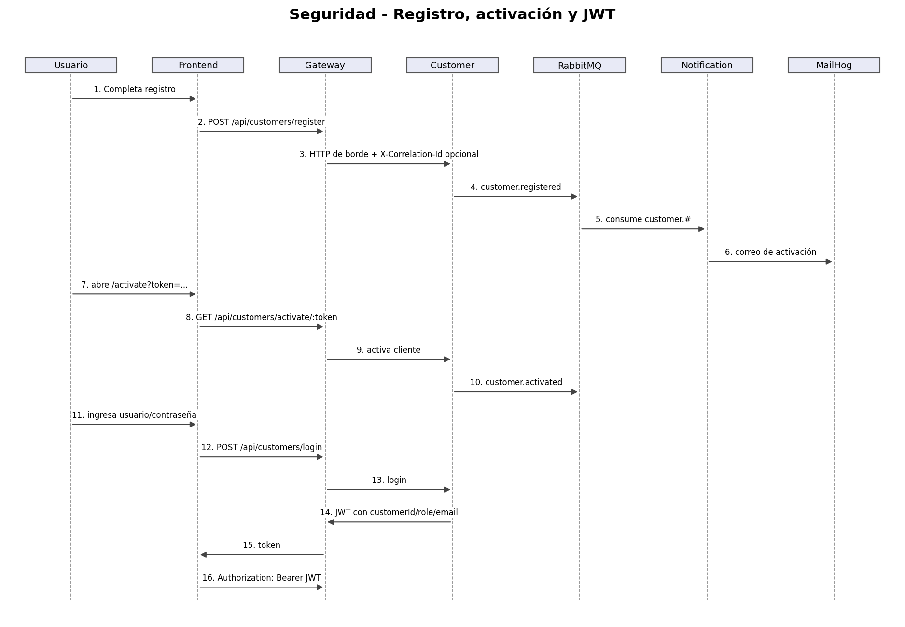

# API Gateway y seguridad

## Responsabilidad del Gateway
El API Gateway NestJS es el único endpoint público del backend. Sus responsabilidades son:
- validar JWT;
- aplicar autorización por roles;
- enrutar request/response hacia el servicio propietario;
- restringir ownership de cuentas para `CLIENT`;
- generar `correlationId` para transferencias;
- publicar `transaction.transfer.requested` y `transaction.interbank.requested` en RabbitMQ;
- exponer el contrato interbancario `/interbank/v1/*` al banco pareja, autenticado con `X-Api-Key`;
- exponer health/readiness agregada.

No realiza validación de fondos, reservas, pagos, débito/crédito ni transiciones de Saga.

## JWT
Customer Service genera el JWT con secreto compartido. Claims relevantes:
- `sub`: username;
- `customerId`;
- `role`;
- `email`;
- `iat`;
- `exp`.

El Gateway verifica el token con `JwtGuard` y los permisos con `RolesGuard`.

## Roles
| Operación | CLIENT | CASHIER | ADMIN |
|---|:---:|:---:|:---:|
| Registro/activación/login | público | público | público |
| Perfil propio | sí | sí | sí |
| Crear/consultar cuentas | propias | sí | sí |
| Iniciar transferencia o depósito a otro banco | sí | no | no |
| Consultar pagos | no | sí | sí |
| Consultar auditoría | no | no | sí |
| Inyectar fallos en Payment (`/api/admin/payment-simulation`) | no | no | sí |
| Mantenimiento de cuentas inactivas | no | sí | sí |

## Protección de ownership
En cuentas, un `CLIENT` no puede elegir arbitrariamente `customerId`; el Gateway fuerza el `customerId` contenido en el JWT. Para una transferencia, el Gateway consulta la cuenta origen y rechaza la solicitud si no pertenece al cliente autenticado.

## Seguridad interna en Kubernetes
Los cinco microservicios y el simulador se exponen como `ClusterIP`. En producción el Gateway es la única entrada: un Service `LoadBalancer` para el proxy `/api` del frontend y un Ingress **solo HTTPS** para el banco pareja. En kind local, Frontend y Gateway usan `NodePort` y la `NetworkPolicy` de backend permite ingress solo desde el Gateway y RabbitMQ ([NetworkPolicy](../04-despliegue/03-network-policy.md)).

## Rutas interbancarias y de administración

| Ruta | Autenticación | Rol | Destino | Notas |
|---|---|---|---|---|
| `POST /api/interbank-transfers` | JWT | CLIENT | publica `transaction.interbank.requested` | Valida que la cuenta origen sea del cliente, `destinationBankCode` con formato `BANKnn`, cuenta destino de 1 a 34 caracteres alfanuméricos y monto de hasta 2 decimales. Responde `202` con `correlationId` y **`traceId`** |
| `GET /api/interbank-transfers/:correlationId` | JWT | CLIENT (solo los suyos), CASHIER, ADMIN | Transaction | Estado de la Saga, `interbankState`, banco destino y motivo de rechazo |
| `GET/POST/DELETE /api/admin/payment-simulation` | JWT | ADMIN | Payment `/internal/payment-simulation` | Inyección de fallos en caliente (`failureRate`, `timeoutRate`, `timeoutMs`, `latencyMs`). El Gateway agrega `X-Admin-Token` desde el Secret `bank-interbank-secret`; el cliente nunca lo ve |
| `GET /interbank/v1/health` | ninguna | — | Payment | Salud para el banco pareja |
| `POST /interbank/v1/transfers`, `GET /interbank/v1/transfers/{id}`, `POST /interbank/v1/transfers/{id}/cancel`, `POST /interbank/v1/transfers/{id}/result`, `POST /interbank/v1/reversals`, `GET /interbank/v1/reversals/{id}`, `GET /interbank/v1/reconciliation` | `X-Api-Key` | banco pareja | Payment `/interbank/v1/*` | Rutas explícitas del contrato del curso, sin comodín. Los `{id}` se codifican, así que `../internal` no llega a Payment. `/internal/*` nunca se expone |

### Modelo de API keys interbancarias

- **Una clave por banco**, guardada en el Secret `gateway-interbank-keys` (`INTERBANK_API_KEYS={"BANK13":"…","BANK99":"…"}`). Nunca va en el repositorio.
- El Gateway compara la `X-Api-Key` recibida con cada clave en tiempo constante (`timingSafeEqual`). Si ninguna coincide, responde `401` con el esquema `Error` del contrato.
- El banco que llama se deduce de **la clave**, no de lo que diga el cliente: el Gateway **borra** cualquier `X-Caller-Bank-Code` entrante y lo reescribe con el código dueño de la clave. Payment lo usa para que cada banco solo consulte, cancele o reciba callbacks de sus propias transferencias.
- `traceparent` es obligatorio (`400` si falta) y se propaga, de modo que el depósito tiene el mismo `traceId` en ambos bancos. También se reenvían `Idempotency-Key` y, en las respuestas, `Retry-After`.
- Las claves **salientes** (las que usamos para llamar al banco pareja) viven en otro Secret, `bank-interbank-secret` (`INTERBANK_PARTNERS`), y solo las usa Payment.
- Solo HTTPS: el banco pareja entra por el Ingress con `ManagedCertificate` (`https://35-244-157-47.sslip.io`). El Ingress tiene `allow-http: false`.

### Resiliencia del Gateway

- Toda llamada a un servicio interno se corta a los 5 s (`PROXY_TIMEOUT_MS`). Si el servicio no responde, el Gateway devuelve **503** en vez de dejar la petición colgada (hallazgo del escenario 3, [postmortem](../postmortems/2026-10-21-escenario3-account-caido.md)).
- HPA de 1 a 3 réplicas al 80 % de CPU, con sondas de 3 s de timeout (hallazgo de la prueba de estrés).
- Instrumentado con OpenTelemetry:
  - span HTTP por petición con el atributo `bank.correlation_id`;
  - span `publish <routing key>` al publicar en RabbitMQ;
  - logs JSON sin `Authorization` ni `X-Api-Key`.
