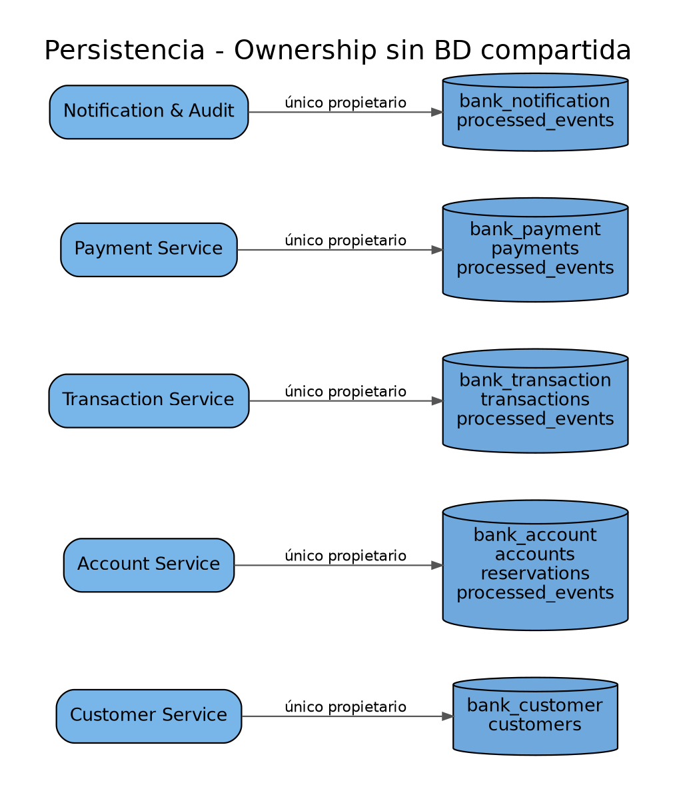

# Persistencia y data ownership

## Bases independientes
| Microservicio | Base | Puerto Docker host | Tablas principales |
|---|---|---:|---|
| Customer | `bank_customer` | 5433 | `customers` |
| Transaction | `bank_transaction` | 5434 | `transactions`, `customer_kyc_status`, `processed_events` |
| Notification/Audit | `bank_notification` | 5435 | `processed_events`, `notification_outbox`, `notification_customer_contacts` |
| Account | `bank_account` | 5436 | `accounts`, `transfer_reservations`, `interbank_operations`, `processed_events` |
| Payment | `bank_payment` | 5437 | `payments`, `interbank_transfers`, `interbank_reversals`, `processed_events` |

El detalle de columnas está en [Modelo de dominio](02-modelo-dominio.md#diagrama-entidad-relación).

## Reglas de ownership
1. Cada servicio configura únicamente una conexión de base de datos.
2. Ningún servicio consulta tablas de otro bounded context.
3. Los identificadores externos se transportan en eventos o requests como valores, no como claves foráneas entre bases.
4. La consistencia entre contextos es eventual y se resuelve con Saga.

## Dónde viven las bases
- **Desarrollo:** las cinco PostgreSQL corren en Docker Compose, fuera del cluster. En kind, `start-k8s.sh` detecta la IP gateway del host y reemplaza `__HOST_GATEWAY__` en los manifiestos antes del despliegue.
- **Producción:** cinco instancias Cloud SQL (PostgreSQL 17, IP privada en `bank-usac-vpc`) creadas con Terraform, una por servicio ([ADR-012](05-decisiones-arquitectura.md), [Terraform](../04-despliegue/05-terraform-cloud-sql.md)).

En ambos entornos la base queda fuera del cluster de Kubernetes y cada servicio solo se conecta a la suya. El pool de conexiones es de 4 por réplica para respetar el límite de `db-f1-micro` ([capacidad](../04-despliegue/07-despliegue-fase3.md#capacidad-lecciones-de-las-pruebas-de-carga)).

