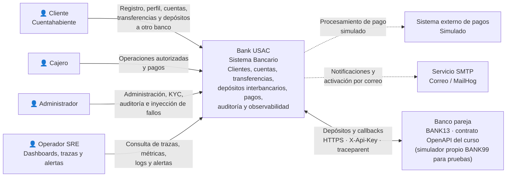

# C4 Nivel 1 — Contexto

## Propósito

El diagrama de contexto representa a Bank USAC como el sistema bancario utilizado por clientes, cajeros y administradores. El API Gateway se mantiene como punto único de entrada para las solicitudes de usuario.

Bank USAC se integra con un **banco pareja** (BANK13) para enviar y recibir depósitos interbancarios, y se observa con un stack propio de trazas, métricas, logs y alertas. La arquitectura sigue desacoplada: gestión KYC, tipos de cuenta, historial de transacciones, simulación de pagos externos y clasificación de eventos se conservan de las fases anteriores.

## Actores

### Cliente

El cliente utiliza Bank USAC para:

- administrar su perfil;
- consultar el estado KYC;
- consultar sus cuentas;
- solicitar transferencias;
- consultar operaciones disponibles para su rol.

Solo los clientes cuyo estado KYC es `VERIFIED` pueden participar en una transferencia válida.

### Cajero

El cajero accede a funciones operativas autorizadas, incluyendo operaciones relacionadas con cuentas y pagos.

### Administrador

El administrador dispone de funciones de supervisión, actualización del estado KYC, consulta del historial de auditoría y notificaciones clasificadas (filtrable por `correlationId` y `traceId`) e inyección de fallos controlados en Payment para las pruebas.

### Operador / equipo SRE

Consulta dashboards, trazas, logs y alertas en el stack de observabilidad (Grafana, Tempo, Loki y Prometheus) y atiende los runbooks de cada alerta.

## Sistemas externos

### Sistema externo de pagos

Payment Service simula la interacción con un proveedor externo. La respuesta puede ser:

- `SUCCESS`;
- `FAILURE`;
- `TIMEOUT`.

La integración se representa como externa aunque en el entorno académico la respuesta sea simulada.

### Banco pareja (BANK13)

Otro banco que implementa el mismo contrato OpenAPI del curso. Bank USAC le envía depósitos y recibe los suyos por HTTPS, autenticado con `X-Api-Key` y con el header `traceparent`, de modo que cada depósito comparte el mismo `traceId` en ambos bancos. Para pruebas y fallos controlados se usa un banco simulado propio (`interbank-mock`, BANK99), nunca el sistema del otro grupo.

### Servicio de correo

Notification & Audit utiliza un servicio SMTP para correos de activación y otras notificaciones. En el entorno de demostración se utiliza MailHog.

## Límite del sistema

En este nivel Bank USAC se representa como un único sistema. El API Gateway, los cinco microservicios, RabbitMQ, sus bases de datos y el stack de observabilidad son detalles internos que se muestran en el [C4 Nivel 2](09-c4-contenedores.md).

El API Gateway continúa siendo el punto único de entrada HTTP, también para el banco pareja (`/interbank/v1`, solo HTTPS). Entre los microservicios de negocio no se utiliza comunicación HTTP directa: la coordinación distribuida se realiza mediante eventos.

## Diagrama

## Capacidades incorporadas por fase

| Fase | Capacidades que aparecen en el contexto |
|---|---|
| 2 | Estado KYC `PENDING`, `VERIFIED` y `REJECTED`; validación KYC previa a transferencias; simulación de proveedor externo de pagos; notificaciones `INFO`, `WARNING` y `ERROR`; trazabilidad con `eventId` y `correlationId` |
| 3 | Depósitos interbancarios con el banco pareja (idempotencia, timeout, reversos y conciliación); observabilidad con OpenTelemetry, SLO y alertas; operador SRE; despliegue en GCP |
