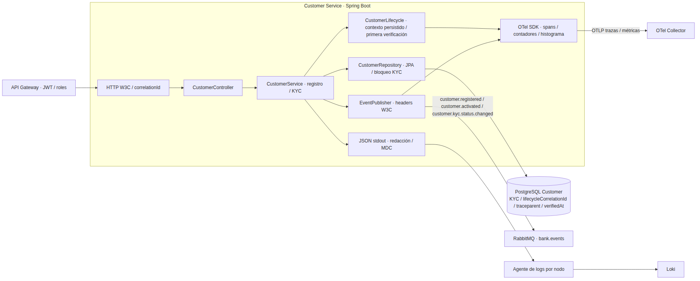
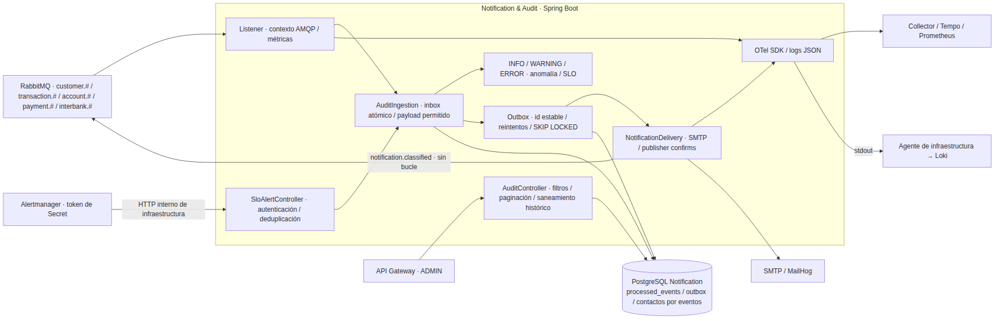

# C4 Nivel 3 — Customer y Notification & Audit

Diagramas de componentes de Customer Service y Notification & Audit Service, con los cambios de observabilidad de la Fase 3. Los de Account, Payment y Transaction están en el [catálogo de diagramas](06-catalogo-diagramas.md).

## Customer Service

Customer Service administra clientes, autenticación, perfil y estado KYC.

### Componentes

| Componente | Responsabilidad |
|---|---|
| `CustomerController` | Expone endpoints REST de registro, autenticación, perfil y actualización KYC |
| `CustomerService` | Implementa reglas de negocio de clientes y transiciones KYC |
| `CustomerRepository` | Acceso exclusivo a `bank_customer` mediante JPA; bloquea la fila para serializar las transiciones KYC |
| `EventPublisher` | Publica eventos de Customer en `bank.events` con el `traceparent` en los headers AMQP |
| `RequestTracingFilter` | Continúa el contexto W3C de la petición HTTP y registra el `correlationId` |
| `CustomerLifecycle` | Persiste el `correlationId` y el contexto de traza del registro para enlazar la verificación KYC posterior; mide la primera verificación |
| Seguridad JWT | Autentica solicitudes y restringe operaciones según rol |
| `Customer`, `KycStatus`, DTO | Modelo de dominio y contratos internos |

### Flujo KYC

La actualización del estado KYC sigue el flujo:

`API Gateway → CustomerController → CustomerService → CustomerRepository`

Cuando el estado cambia se publica:

`customer.kyc.status.changed`

Payload principal:

- `customerId`;
- `estadoAnterior`;
- `estadoNuevo`.

Los estados admitidos son:

- `PENDING`;
- `VERIFIED`;
- `REJECTED`.

Si se solicita establecer nuevamente el mismo estado, el servicio mantiene comportamiento idempotente y no publica un evento duplicado.

### Diagrama

---

## Notification & Audit Service

Notification & Audit consume eventos del sistema, evita procesamientos duplicados, los clasifica y conserva su historial.

### Componentes

| Componente | Responsabilidad |
|---|---|
| `CustomerEventListener` | Subscriber RabbitMQ para eventos de Customer, Account, Transaction, Payment e interbancarios; continúa el contexto de traza del mensaje |
| `AuditIngestion` | Inserta la auditoría (`ON CONFLICT DO NOTHING`) y las tareas de entrega en una sola transacción; el `ack` llega después del commit |
| `EventClassificationService` | Clasifica eventos como `INFO`, `WARNING` o `ERROR` (incluye `account.anomaly.detected` y las alertas de SLO) |
| `NotificationDelivery` | Worker del outbox (`FOR UPDATE SKIP LOCKED`): envía correos por SMTP y publica `notification.classified` con confirmaciones; tras 10 fallos la tarea queda `FAILED` |
| `ProcessedEventRepository` | Persiste eventos e implementa idempotencia por `eventId` |
| `AuditController` | Expone `GET /api/audit/events` con filtros (`correlationId`, `traceId`, servicio, nivel) y paginación |
| `SloAlertController` | Recibe las alertas de Alertmanager en `POST /internal/alerts/slo` (Bearer desde Secret) y las deduplica |
| `ProcessedEvent`, `NotificationOutbox` | Almacenan trazabilidad, payload saneado y clasificación, y las tareas de entrega |

### Clasificación

Ejemplos implementados:

| Evento / resultado | Clasificación |
|---|---|
| KYC `VERIFIED` | `INFO` |
| KYC `REJECTED` | `WARNING` |
| `payment.approved` | `INFO` |
| `payment.rejected` con `reason` `EXTERNAL_FAILURE` | `ERROR` |
| `payment.rejected` con otro `reason` (`TIMEOUT`, `PAYMENT_LIMIT_EXCEEDED`, `INVALID_AMOUNT`) | `WARNING` |
| `account.funds.rejected` | `WARNING` |
| `transaction.compensated` | `WARNING` |
| `transaction.status.changed` a `FAILED`, o eventos `*.failed` | `ERROR` |
| `account.anomaly.detected` | `WARNING` |
| Cualquier otro evento | `INFO` |

### Idempotencia y trazabilidad

Antes de procesar un evento se consulta su `eventId`.

Si ya existe, el evento se ignora y no se vuelve a persistir ni se genera una nueva clasificación.

Los eventos derivados preservan el `correlationId` del flujo original.

`notification.classified` utiliza además `causationId` para relacionar el nuevo evento con el evento que originó la clasificación.

### Persistencia

`ProcessedEventRepository` utiliza exclusivamente la base:

`bank_notification` (`processed_events`, `notification_outbox` y `notification_customer_contacts`)

Cada evento nuevo puede almacenar:

- `eventId`;
- `eventType`;
- `version`;
- `correlationId`;
- payload;
- timestamp del evento;
- timestamp de procesamiento;
- severidad;
- origen;
- `traceId`, `spanId` y servicio de origen;
- mensaje de clasificación.

### Diagrama

