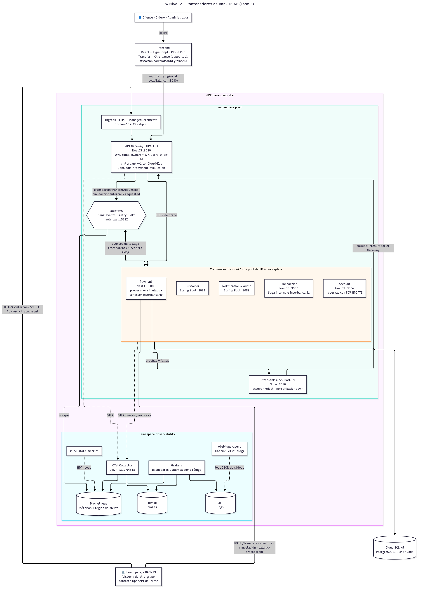

# 10. C4 Nivel 2 — Contenedores Fase 3

## Propósito

Actualiza el [C4 de contenedores de la Fase 2](09-c4-contenedores-fase2.md) con lo que agrega la Fase 3:
- el **stack de observabilidad**;
- la **integración interbancaria** con el banco pareja (BANK13) y su simulador (BANK99);
- la entrada **HTTPS** del Gateway;
- los cambios de capacidad que salieron de las pruebas de carga.

Fuente Mermaid: [`c4-src/c4-container-fase3.mmd`](c4-src/c4-container-fase3.mmd).

## Contenedores nuevos o cambiados

| Contenedor | Tecnología | Qué cambia en la Fase 3 |
| ---------- | ---------- | ----------------------- |
| Frontend | React + TypeScript en Cloud Run | Página **Otro banco** (`/interbank`): envía depósitos a BANK13 o al mock, sigue su estado y muestra `correlationId` y `traceId` |
| Ingress HTTPS | GKE Ingress `gce` + `ManagedCertificate`, IP global `35.244.157.47` | Entrada **solo HTTPS** para el banco pareja: `https://35-244-157-47.sslip.io/interbank/v1` |
| API Gateway | NestJS `:8080`, HPA de 1 a 3 réplicas | `/interbank/v1/*` hacia Payment con `X-Api-Key` y `traceparent` obligatorio; `/api/interbank-transfers`; `/api/admin/payment-simulation` (ADMIN); OpenTelemetry; responde 503 si un servicio interno no contesta en 5 s |
| Transaction | NestJS `:3003` | Saga del depósito interbancario (`PENDING/SENT/TIMEOUT/ACCEPTED/REJECTED/REVERSED`), histograma `bank.transfer.duration`, estados de la Saga como eventos del span y compensaciones como spans |
| Account | NestJS `:3004` | Reserva, débito y crédito interbancarios. Desde `v0.5.3`, cada operación de saldo corre en una transacción con la fila bloqueada (`FOR UPDATE`) |
| Payment | NestJS `:3005` | Conector con el banco pareja: envío, consulta, cancelación, callbacks, reversos y conciliación. Simulación de fallos ajustable en caliente |
| interbank-mock | Node `:3010`, `BANK99` | Banco pareja simulado con el mismo contrato OpenAPI; modos `accept`, `reject`, `no-callback` y `down`, latencia y retraso del callback |
| RabbitMQ | RabbitMQ 4 | Expone métricas en `:15692` (cola, consumidores, entregas) para el consumer lag |
| Todos los microservicios | HPA de 1 a 5 réplicas | Pool de **4 conexiones** a la base por réplica: 5 réplicas × 4 = 20 conexiones, por debajo de las ~25 de `db-f1-micro` |

## Stack de observabilidad (namespace `observability`)

| Contenedor | Rol |
| ---------- | --- |
| OpenTelemetry Collector | Recibe OTLP (`:4317`/`:4318`) de los servicios: trazas a Tempo y métricas a Prometheus (`:8889`) |
| otel-logs-agent (DaemonSet) | Lee los logs JSON de los contenedores de `prod` y `dev` y los envía a Loki con `service_name`, `traceId` y `correlation_id` |
| Tempo | Almacena las trazas. Una transferencia completa es **una sola traza**, porque `traceparent` viaja por HTTP, por los headers AMQP y hacia y desde el banco pareja |
| Prometheus | Métricas de negocio (`bank_*`), HTTP, RabbitMQ, kube-state-metrics y cAdvisor; reglas de SLO y alertas |
| Loki | Logs centralizados; se consultan por `traceId` desde una traza |
| Grafana | Dashboards y alertas versionados en `observability/dashboards` y `observability/alerts` |
| kube-state-metrics | Réplicas del HPA, pods y despliegues (anotaciones de despliegue) |

## Flujos que cruzan contenedores

- **Transferencia interna:** Frontend → Gateway → `transaction.transfer.requested` → Transaction, Account y Payment por RabbitMQ (sin cambios desde la Fase 2).
- **Depósito saliente:** Frontend → Gateway → `transaction.interbank.requested` → Transaction → Account (reserva) → Payment → banco pareja → callback por el Ingress y el Gateway → Payment → Account → Transaction. Detalle en [Depósito interbancario](../03-saga/02-deposito-interbancario.md).
- **Depósito entrante:** banco pareja → Ingress → Gateway (`X-Api-Key`) → Payment → Account → callback de Payment al banco pareja.
- **Telemetría:** los servicios envían trazas y métricas por OTLP al Collector y escriben logs por stdout, que el agente lleva a Loki. Prometheus además scrapea RabbitMQ, kube-state-metrics y cAdvisor.

Ver también: [Diagrama de despliegue Fase 3](../04-despliegue/07-despliegue-fase3.md) y [Catálogo de métricas](../observabilidad/catalogo-metricas.md).
