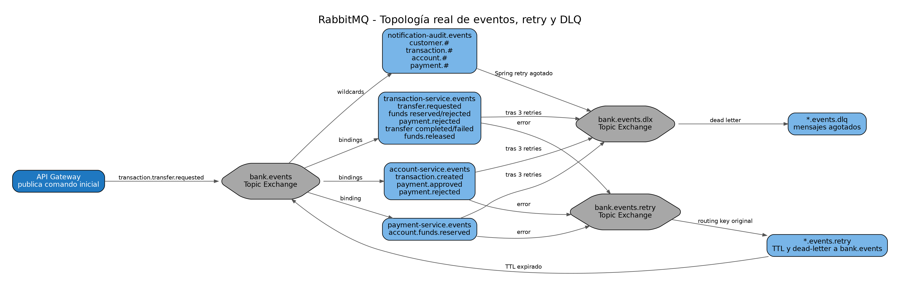
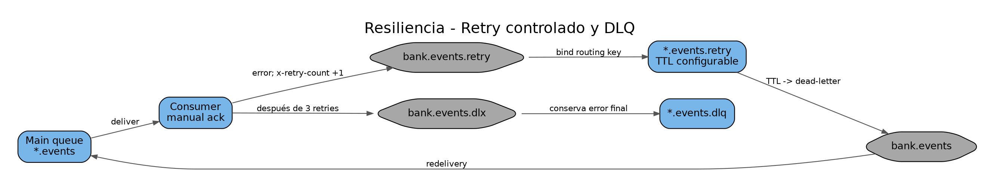

# Topología RabbitMQ

## Exchanges
| Exchange | Tipo | Uso |
|---|---|---|
| `bank.events` | topic | eventos normales |
| `bank.events.retry` | topic | eventos que requieren reintento |
| `bank.events.dlx` | topic | eventos agotados / dead letter |

## Colas principales
### `transaction-service.events`
Bindings:
- `transaction.transfer.requested`
- `account.funds.reserved`
- `account.funds.rejected`
- `payment.rejected`
- `account.transfer.completed`
- `account.transfer.failed`
- `account.funds.released`
- `customer.kyc.status.changed`

Depósito interbancario:
- `transaction.interbank.requested`
- `account.interbank.funds.reserved`
- `account.interbank.funds.rejected`
- `account.interbank.transfer.completed`
- `account.interbank.funds.released`
- `account.interbank.deposit.credited`
- `interbank.transfer.sent`, `interbank.transfer.timeout`, `interbank.transfer.accepted`, `interbank.transfer.rejected`, `interbank.transfer.reversed`

### `account-service.events`
Bindings:
- `transaction.created`
- `payment.approved`
- `payment.rejected`
- `interbank.transfer.requested`, `interbank.transfer.accepted`, `interbank.transfer.rejected`, `interbank.transfer.reversed`
- `interbank.deposit.requested`, `interbank.reversal.requested`

### `payment-service.events`
Bindings:
- `account.funds.reserved`
- `account.interbank.funds.reserved`
- `account.interbank.deposit.credited`, `account.interbank.deposit.rejected`
- `account.interbank.reversal.debited`, `account.interbank.reversal.failed`

### `notification-audit.events`
Bindings wildcard:
- `customer.#`
- `transaction.#`
- `account.#`
- `payment.#`
- `interbank.#`

`notification.classified` no se vuelve a consumir en esta cola, para evitar bucles.

## Retry
Transaction, Account y Payment usan colas `.retry` durables con TTL. Al expirar el TTL, el mensaje regresa a `bank.events` conservando la routing key original. El header `x-retry-count` limita la cantidad de intentos a 3 por defecto.

Notification/Audit usa retry stateless de Spring con 3 reintentos y posteriormente dead-lettering (`notification-audit.events.dlq`).

## Métricas del broker
RabbitMQ expone sus métricas en `:15692` (plugin `rabbitmq_prometheus`). Prometheus las scrapea y el dashboard *Infraestructura, HPA y broker* muestra el consumer lag por cola ([catálogo de métricas](../observabilidad/catalogo-metricas.md)).

## DLQ
Cada participante posee una cola dead-letter para evitar pérdida silenciosa y permitir inspección manual.

