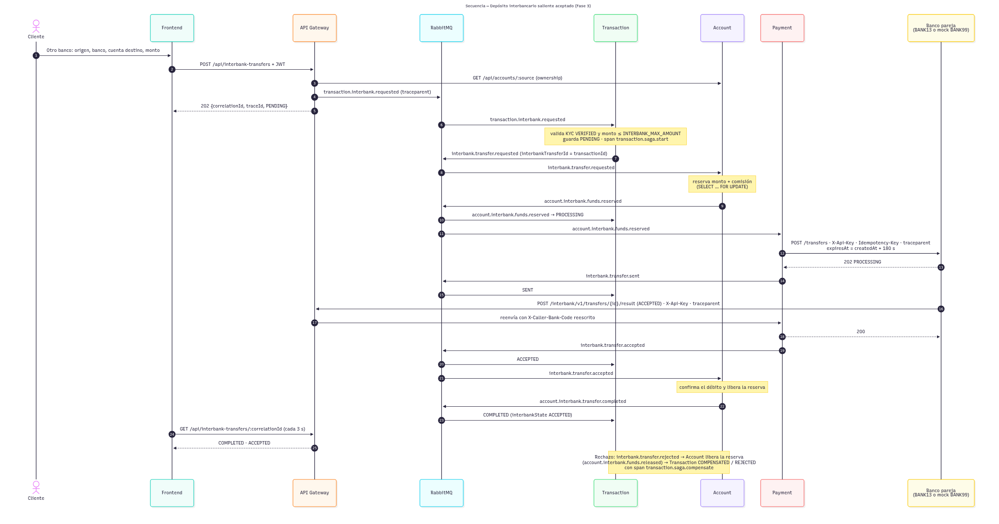
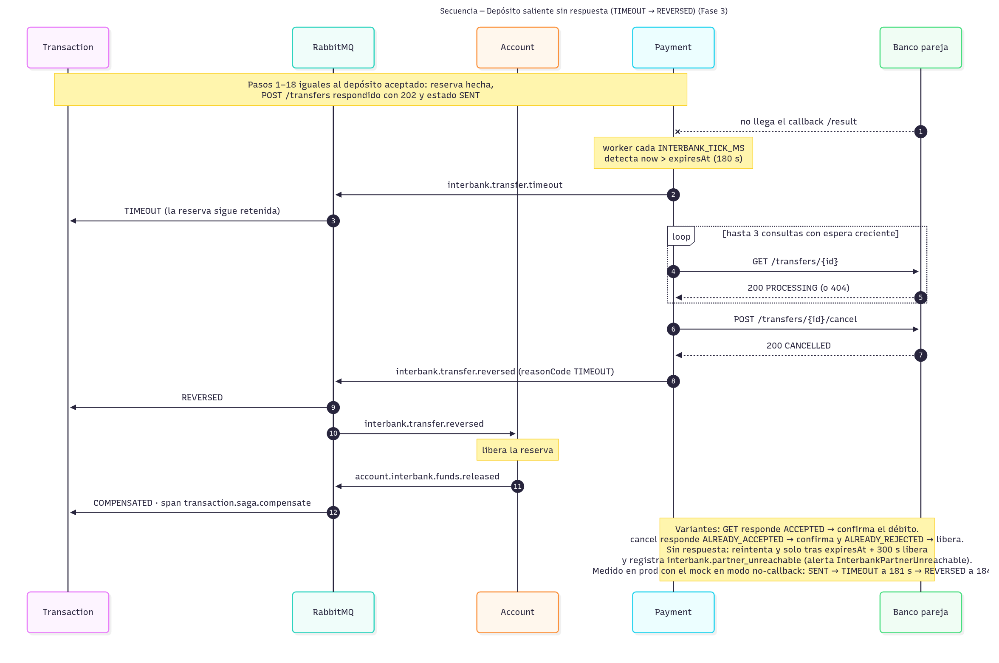
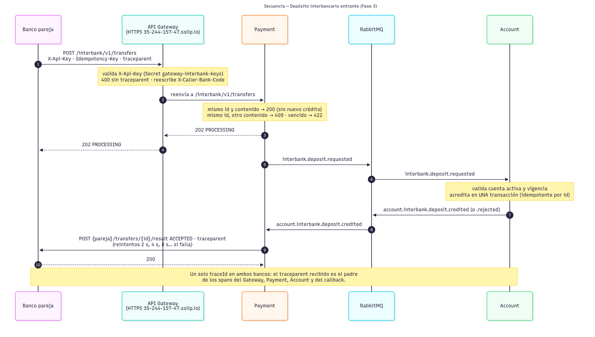

# Saga del depósito interbancario

El depósito a otro banco sigue el mismo estilo que la [transferencia interna](01-saga-transferencia.md): coreografía por RabbitMQ, sin transacción global. Lo nuevo es el **banco pareja**, que se alcanza por HTTP según el contrato OpenAPI del curso (`docs/interbank/openapi.yaml`, sin modificar). Payment es la única frontera con el otro banco. El diseño completo de eventos e interfaces está en [diseño interbancario](../interbank/diseno-interbancario.md).

## Estados

Transaction guarda dos estados por depósito:

| Campo | Valores | Significado |
|---|---|---|
| `status` (Saga interna) | `PENDING`, `PROCESSING`, `COMPLETED`, `FAILED`, `COMPENSATING`, `COMPENSATED` | Avance dentro de nuestro banco. Estado público: `PENDING`, `APPROVED` o `FAILED` |
| `interbankState` | `PENDING`, `SENT`, `TIMEOUT`, `ACCEPTED`, `REJECTED`, `REVERSED` | Estado frente al banco pareja |

Un estado final (`ACCEPTED`, `REJECTED`, `REVERSED`) nunca se sobrescribe con `SENT` ni con `TIMEOUT`, aunque esos eventos lleguen tarde (`INTERBANK_STAGE` en `interbank-state.enum.ts`).

## 1. Depósito saliente aceptado

Fuente: [`sequence-interbank-outgoing.mmd`](../01-arquitectura/c4-src/sequence-interbank-outgoing.mmd).

- `interbankTransferId` = `transactionId`, que viaja como `Idempotency-Key`: un reintento nunca crea un segundo depósito.
- Se reserva el monto más la comisión antes de llamar al otro banco. El débito se confirma solo con el callback `ACCEPTED`.
- Si el otro banco rechaza (`interbank.transfer.rejected`), Account libera la reserva y Transaction termina en `COMPENSATED` con `interbankState = REJECTED`. La compensación aparece en la traza como el span `transaction.saga.compensate`.
- Si Account no puede reservar (fondos, cuenta inactiva o límite), publica `account.interbank.funds.rejected` y no se llama al otro banco: queda `FAILED` / `REJECTED`.

## 2. Depósito saliente sin respuesta (timeout del contrato)

Fuente: [`sequence-interbank-timeout.mmd`](../01-arquitectura/c4-src/sequence-interbank-timeout.mmd).

- `expiresAt` = `createdAt` + 180 s. Al vencer, el depósito pasa a `TIMEOUT` y **la reserva sigue retenida** hasta saber qué hizo el otro banco.
- Payment consulta (`GET /transfers/{id}`) y, si sigue en proceso o no existe, cancela (`POST /transfers/{id}/cancel`). La respuesta decide si se confirma el débito o se libera la reserva (`REVERSED`).
- Si el otro banco no contesta nada, Payment sigue reintentando. Solo libera tras `expiresAt` + 300 s y deja el log `interbank.partner_unreachable`, que dispara la alerta `InterbankPartnerUnreachable`.
- **Verificado en prod** con el mock en modo `no-callback`: `SENT` → `TIMEOUT` a los 181 s → `REVERSED` a los 184 s, con el saldo intacto.

## 3. Depósito entrante

Fuente: [`sequence-interbank-incoming.mmd`](../01-arquitectura/c4-src/sequence-interbank-incoming.mmd).

- El Gateway valida `X-Api-Key` (una clave por banco, Secret `gateway-interbank-keys`) y exige `traceparent`. Además **reescribe** `X-Caller-Bank-Code` con el banco dueño de la clave, así nadie puede hacerse pasar por otro banco.
- Idempotencia por `interbankTransferId`:
  - el mismo id con el mismo contenido responde `200` y no acredita de nuevo;
  - el mismo id con otro contenido responde `409`;
  - un depósito vencido responde `422`.
- Account acredita en una sola transacción y nunca acredita un depósito vencido o cancelado.
- Transaction escucha `account.interbank.deposit.credited` y guarda el depósito como `COMPLETED` / `ACCEPTED`, con `originBankCode` y la cuenta de origen. Así el cliente lo ve como *Recibida* en su historial. Es solo un registro: si Transaction falla, el crédito y el callback al otro banco no se ven afectados.
- **Verificado en prod** con el mock: crédito de Q10. El reenvío idéntico respondió 200 sin doble crédito, el mismo id con otro monto respondió 409, y el `traceId` fue el mismo en el mock y en Payment.

## Observabilidad del flujo

| Señal | Dónde |
|---|---|
| Una sola traza por depósito (Gateway → Transaction → Account → Payment → banco pareja → callback) | Tempo. El `traceId` lo devuelve `POST /api/interbank-transfers` y lo muestra la página *Otro banco* |
| `bank_transfer_duration_seconds{type="interbank"}` (p50/p95/p99) y `bank_operations_total{operation="transaction.transfer.interbank"}` | Prometheus; dashboard *Bank USAC - Transferencias y API Gateway* |
| `bank_interbank_transfers_total{role,state}` | Prometheus; panel interbancario del dashboard de SLO |
| Logs `interbank.*` con `traceId` y `correlation_id` | Loki: `{service_name="payment-service"} \| json \| event=~"interbank.*"` |
