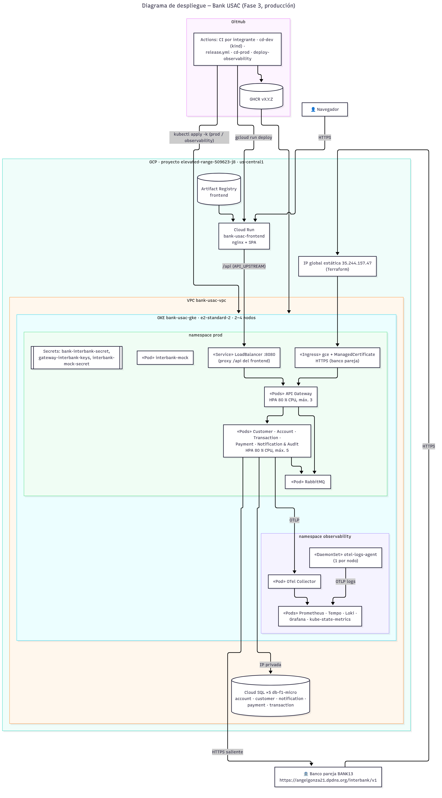

# Despliegue

Dónde corre cada parte de Bank USAC en los dos entornos: desarrollo (Kubernetes efímero con kind) y producción (GCP). El paso de uno a otro es solo por pipeline ([CI/CD](04-ci-cd.md)) y la infraestructura de producción la crea [Terraform](05-terraform-cloud-sql.md). Las únicas excepciones manuales son los Secrets, que se crean fuera del repositorio y se listan abajo.

## Entorno de desarrollo

- **Cluster kind.** En el pipeline (`cd-dev.yml` y `release.yml`) se crea un cluster kind efímero en el runner y se despliega `k8s/overlays/dev` en el namespace `dev`, con las imágenes `sha-<commit>` (o las candidatas `vX.Y.Z-rc.<n>`) de GHCR, y se corre el smoke test. En local, `scripts/project/start-k8s.sh` usa el namespace `bank-usac` con imágenes `:local` ([Kubernetes kind](02-kubernetes-kind.md)).
- **Pods:** API Gateway, Frontend, los cinco microservicios, `interbank-mock`, RabbitMQ y MailHog, con los mismos HPA que en producción.
- **Bases de datos fuera del cluster:** cinco PostgreSQL en Docker Compose, una por microservicio. Los pods llegan a ellas por la IP del host.

## Entorno de producción

Fuente Mermaid: [`c4-src/deployment-fase3.mmd`](../01-arquitectura/c4-src/deployment-fase3.mmd).

## Piezas

| Dónde | Qué | Cómo llega |
|---|---|---|
| GKE `bank-usac-gke` (`us-central1-a`, `e2-standard-2`, autoscaler de 2 a 4 nodos) | namespace `prod`: Gateway, 5 microservicios, RabbitMQ, MailHog e `interbank-mock` | `cd-prod.yml` en cada merge a `main`, con imágenes `vX.Y.Z` de GHCR |
| GKE, namespace `observability` | OTel Collector, `otel-logs-agent` (DaemonSet), Prometheus, Tempo, Loki, Grafana y kube-state-metrics | `deploy-observability.yml` (`kubectl apply -k observability`) en cada push a `develop` o `main` que toque `observability/` |
| Ingress `gce` + `ManagedCertificate` | `https://35-244-157-47.sslip.io`: entrada HTTPS del banco pareja hacia el Gateway | `k8s/overlays/prod/gateway-ingress.yaml`; la IP global estática sale de Terraform (`gateway_ip.tf`) |
| Service `LoadBalancer :8080` del Gateway | Destino del proxy `/api` del frontend (`API_UPSTREAM`) | Overlay `prod` |
| Cloud Run `bank-usac-frontend` | SPA + nginx por HTTPS | `cd-prod.yml` (imagen copiada a Artifact Registry) |
| Cloud SQL ×5 (`db-f1-micro`, PostgreSQL 17, IP privada) | Una base por microservicio | Terraform |

## Capacidad (lecciones de las pruebas de carga)

| Ajuste | Motivo |
|---|---|
| Pool de 4 conexiones por réplica (`DB_POOL_MAX` en Node, `SPRING_DATASOURCE_HIKARI_MAXIMUMPOOLSIZE` en Java) | Con 5 réplicas × 10 conexiones se superaba el límite de `db-f1-micro` (`too many clients`). Regla: réplicas máximas del HPA × pool ≤ conexiones de la base. Ver [postmortem](../postmortems/2026-10-21-estres-account-concurrencia.md) |
| HPA del API Gateway de 1 a 3 réplicas y sondas con `timeoutSeconds: 3` | Con 1 réplica, la liveness vencía bajo estrés y reiniciaba el Gateway en plena carga |
| Límite de memoria de Tempo en 1536Mi | Con 700Mi lo mataba el OOM (`OOMKilled`) al recibir las trazas de la carga |
| Simulación de fallos de Payment en 0 por defecto en prod (`k8s/overlays/prod/payment-simulation.yaml`) | Los valores de desarrollo (10 % de fallos y 5 % de timeouts) contaminaban la línea base |

## Secrets (fuera del repositorio)

| Secret (namespace `prod`) | Claves | Uso |
|---|---|---|
| `bank-interbank-secret` | `INTERBANK_BANK_CODE=BANK08`, `INTERBANK_PARTNERS` (URL y API key de BANK13 y del mock), `ADMIN_TOKEN` | Payment; el Gateway usa `ADMIN_TOKEN` para `/api/admin/payment-simulation` |
| `gateway-interbank-keys` | `INTERBANK_API_KEYS` (`{"BANK13":"…","BANK99":"…"}`) | El Gateway valida `X-Api-Key` y deduce el banco que llama |
| `interbank-mock-secret` | `MOCK_INBOUND_API_KEY`, `MOCK_OUTBOUND_API_KEY`, `MOCK_ADMIN_TOKEN` | Simulador BANK99 |
| `grafana-admin` (namespace `observability`) | Usuario y contraseña de Grafana | Lo crea `deploy-observability.yml` desde un secreto de GitHub |

## Acceso

- Grafana: `kubectl -n observability port-forward svc/grafana 3000:3000`.
- Simulador: `kubectl -n prod port-forward svc/interbank-mock 3010:3010`. Las rutas `/admin/*` nunca se publican; ver `apps/interbank-mock/README.md`.
- Salud interbancaria pública: `GET https://35-244-157-47.sslip.io/interbank/v1/health` (sin autenticación).

## Restricciones respetadas

- Ningún microservicio llama a otro directamente: la comunicación entre microservicios pasa por RabbitMQ. El Gateway publica el comando inicial y hace proxy HTTP de consultas; hacia afuera, solo Payment habla con el banco pareja.
- Las bases de datos viven fuera del cluster en los dos entornos (Docker Compose en desarrollo, Cloud SQL en producción) y cada microservicio accede solo a la suya.
- Producción no se toca a mano: `cd-prod.yml` despliega la aplicación con imágenes versionadas (nunca `latest`) y `deploy-observability.yml` despliega el stack de observabilidad.
