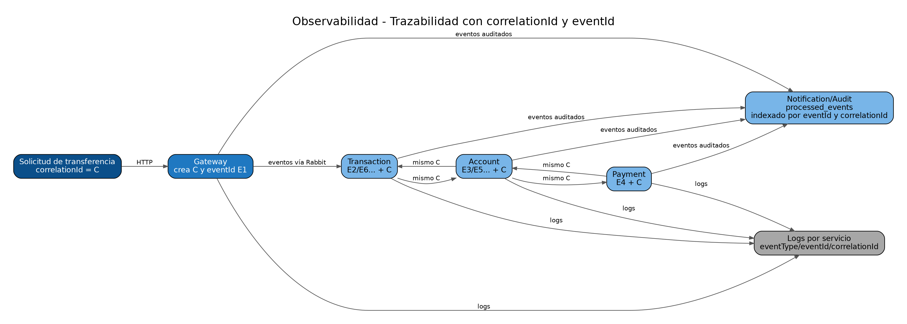

# Resiliencia y observabilidad

## Idempotencia
- Transaction mantiene `processed_events` mediante `EventIdempotencyService`.
- Account mantiene `ProcessedEventEntity`.
- Payment mantiene `ProcessedEventEntity`.
- Notification/Audit usa `eventId` como clave única en `processed_events` (inserción con `ON CONFLICT DO NOTHING`).
- Los depósitos interbancarios usan `interbankTransferId` como `Idempotency-Key`: el mismo id con el mismo contenido no acredita dos veces y con otro contenido responde `409`.

Un evento duplicado no debe repetir el efecto de negocio; cada descarte suma a `bank_events_duplicate_total`.

## Retry y DLQ
Transaction, Account y Payment:
- `noAck: false`;
- `ack` después de procesamiento correcto;
- error -> `bank.events.retry`;
- `x-retry-count` incrementa;
- retry máximo por defecto: 3;
- después del máximo -> `bank.events.dlx` y cola `.dlq`.

Notification/Audit usa `RetryInterceptorBuilder.stateless().maxRetries(3)` y dead-letter routing `notification.audit.failed`. Además persiste la auditoría y las tareas de entrega (correo y eventos) en una sola transacción y hace `ack` después del commit; las tareas pendientes se reintentan desde `notification_outbox`.

## Timeouts y fallos controlados
- El Gateway corta a los 5 s toda llamada a un servicio interno y responde `503` (`PROXY_TIMEOUT_MS`).
- El depósito interbancario vence a los 180 s (`expiresAt`); al vencer, Payment consulta y cancela con el banco pareja y mantiene la reserva hasta conocer el resultado ([Saga interbancaria](../03-saga/02-deposito-interbancario.md)).
- Los fallos se inyectan sin tocar el banco ajeno: `/api/admin/payment-simulation` (procesador de pagos) e `interbank-mock` (modos `reject`, `no-callback`, `down`, latencia). Ver [escenarios de fallo](../pruebas/escenarios-de-fallo.md).
- HPA de 1 a 5 réplicas por microservicio (1 a 3 en el Gateway) al 80 % de CPU.

## Trazabilidad
`correlationId` se mantiene constante durante toda la Saga y `eventId` cambia por evento. El contexto de traza W3C (`traceparent`) viaja por HTTP, por los headers AMQP y hacia el banco pareja; el mismo `traceId` identifica la operación en todos los servicios. Esto permite reconstruir la secuencia completa en:
- Tempo: una traza por transferencia o depósito, con `bank.correlation_id` como atributo de cada span;
- Loki: logs JSON con `traceId`, `spanId` y `correlationId`;
- propiedades AMQP;
- tabla `processed_events` de auditoría;
- endpoint ADMIN `/api/audit/events`, filtrable por `correlationId`, `traceId`, servicio y nivel.

## Observabilidad
| Señal | Cómo se produce | Dónde se consulta |
|---|---|---|
| Trazas | SDK de OpenTelemetry en los cinco servicios y el Gateway, por OTLP al Collector | Tempo, desde Grafana |
| Métricas | Métricas de negocio `bank_*` con OpenTelemetry (percentiles, `outcome`, throughput), más HTTP, RabbitMQ (consumer lag), kube-state-metrics y cAdvisor | Prometheus y Grafana ([catálogo](../observabilidad/catalogo-metricas.md)) |
| Logs | JSON por stdout sin datos sensibles; el DaemonSet `otel-logs-agent` los envía a Loki | Loki, enlazado desde una traza |
| Alertas | 7 reglas en `observability/alerts/` con runbook en `observability/runbooks/`; Alertmanager entrega a Notification (`/internal/alerts/slo`) | Prometheus, Alertmanager y auditoría |

Dashboards como código en `observability/dashboards/`: *Visión general*, *Transferencias y API Gateway*, *SLO Account y Payment*, *Infraestructura, HPA y broker* y *Customer y Auditoría*. Los SLO medidos y su presupuesto de error están en [`docs/sre/slo.md`](../sre/slo.md); las convenciones de nombres y etiquetas, en [convenciones](../observabilidad/convenciones.md).

## Health y readiness
- Gateway: `/health` y `/health/ready` (agregado);
- Customer/Notification: Actuator health; la readiness de Notification depende de la aplicación y su base, no del broker, para seguir recibiendo alertas y consultas si RabbitMQ cae;
- Account/Payment/Transaction: `/health` o probes TCP según manifiesto.

