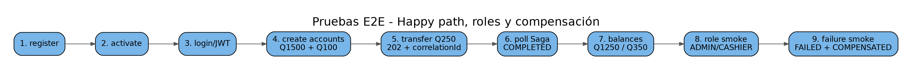

# Estrategia de pruebas

## Validación estática/build
El CI de cada rama `feature/**` compila los servicios y ejecuta sus pruebas unitarias; cualquier fallo detiene el pipeline (detalle en [CI/CD](../04-despliegue/04-ci-cd.md)).

| Servicio | Herramienta | Comando |
|---|---|---|
| Customer, Notification & Audit | JUnit (Maven) | `mvn -B clean test` |
| Account, Payment, Transaction, API Gateway, simulador `interbank-mock` | Vitest | `npm test` (incluye la Saga interbancaria, el contrato `/interbank/v1`, las API keys por banco, el 503 rápido del Gateway y los modos del simulador) |
| Frontend | Vitest | `npm test` (filtros del historial, estados de la Saga, errores HTTP) |

## E2E happy path
`tests/e2e/smoke.sh` ejecuta:
1. registro;
2. activación;
3. login/JWT;
4. creación de cuentas Q1500 y Q100;
5. transferencia Q250;
6. polling por `correlationId`;
7. verificación `COMPLETED`;
8. saldos Q1250 y Q350.

Wrappers:
```bash
./scripts/project/smoke-local.sh
./scripts/project/smoke-k8s.sh
```

## Roles
```bash
./scripts/project/smoke-roles-local.sh
./scripts/project/smoke-roles-k8s.sh
```
Valida ADMIN en auditoría, CASHIER en pagos y denegación de auditoría al cajero.

## Fallo y compensación
```bash
./scripts/project/smoke-saga-failures-local.sh
./scripts/project/smoke-saga-failures-k8s.sh
```
Escenarios:
- fondos insuficientes -> `FAILED`;
- Payment rechaza después de reserva -> `COMPENSATED` y saldo restaurado.

## Pruebas de carga
`tests/load/transfers.js` (k6) recorre la Saga completa contra producción con tres perfiles: `smoke`, `load` (5 transferencias/s) y `stress` (hasta 25/s). Instrucciones en [pruebas de carga](../pruebas/carga.md); los resultados de la prueba de estrés y su verificación están en el [postmortem de estrés](../postmortems/2026-10-21-estres-account-concurrencia.md).

## Escenarios de fallo
Con la carga corriendo se inyectan fallos controlados: procesador de pagos degradado (`/api/admin/payment-simulation`), caída de Account y el banco pareja simulado (`interbank-mock` en modos `reject`, `no-callback` o `down`). Cada escenario termina en un postmortem. Ver [escenarios de fallo](../pruebas/escenarios-de-fallo.md) y [postmortems](../postmortems/).


