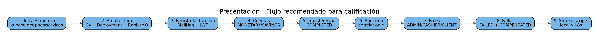

# Guía de demostración para calificación

La demostración se hace sobre producción (GKE `prod` y Cloud Run). Accesos:
- Frontend: URL del servicio Cloud Run `bank-usac-frontend` (la deja `cd-prod.yml` en el resumen del run).
- Contrato interbancario: `https://35-244-157-47.sslip.io/interbank/v1` (`GET /health` sin autenticación).
- Grafana: `kubectl -n observability port-forward svc/grafana 3000:3000`.
- MailHog: `kubectl -n prod port-forward svc/mailhog 8025:8025`.

## Orden recomendado

**Plataforma**
1. `kubectl -n prod get pods,hpa` y `kubectl -n observability get pods`: aplicación, HPA y stack de observabilidad corriendo.
2. C4 Nivel 2 y despliegue ([contenedores](../01-arquitectura/09-c4-contenedores.md), [despliegue](../04-despliegue/07-despliegue-fase3.md)).
3. CI/CD: último `CD - Deploy prod` y `deploy-observability` en verde (GitHub Actions) y la imagen `vX.Y.Z` en GHCR ([CI/CD](../04-despliegue/04-ci-cd.md)).

**Flujo de negocio**
4. Registro de un CLIENT desde el frontend y correo de activación en MailHog.
5. Login, crear `MONETARY Q1500` y `SAVINGS Q100`.
6. Transferir antes de verificar el KYC: termina `FAILED` con "Cliente sin verificación KYC".
7. ADMIN verifica el KYC en **Clientes** → **Verificar**.
8. Transferir Q250 desde **Transferir**: avanza solo hasta **Completada**, con su `correlationId` en pantalla. Saldos Q1250/Q350.
9. **Otro banco:** depósito a BANK13 (o a BANK99, el simulador) y seguimiento del estado frente al banco pareja (`SENT` → `ACCEPTED`); la página muestra el `correlationId` y el `traceId`.
10. **Historial** filtrado por estado y **auditoría** (ADMIN) con el mismo `correlationId` en todos los eventos.

**Observabilidad**
11. Tempo: buscar la transferencia del paso 8 con TraceQL `{ span.bank.correlation_id = "<correlationId>" }` y mostrar la Saga completa en **una sola traza** (Gateway → Transaction → Account → Payment). Hacer lo mismo con el `traceId` del depósito del paso 9.
12. Desde un span, *Logs for this span*: los logs JSON de esa traza en Loki.
13. Dashboards *Transferencias y API Gateway* (p50/p95/p99, disponibilidad del Gateway), *SLO Account y Payment* (SLI de 30 días, presupuesto de error, burn rate) e *Infraestructura, HPA y broker* (réplicas del HPA, consumer lag, anotaciones de despliegue).
14. Alertas y runbooks: las reglas en Prometheus y `observability/runbooks/`.

**Fallos controlados**
15. Inyectar un fallo con `POST /api/admin/payment-simulation` (ADMIN) y mostrar las Sagas compensadas en el dashboard y en una traza con `transaction.saga.compensate`. Quitarlo con `DELETE`.
16. Postmortems: [docs/postmortems/](../postmortems/).

## Frase clave sobre asincronía
> Los cinco microservicios no se invocan entre sí por HTTP para ejecutar una transferencia. El Gateway publica el comando inicial y Transaction, Account, Payment y Notification/Audit avanzan mediante eventos RabbitMQ. Las llamadas HTTP Gateway->servicio son tráfico de borde, no comunicación inter-microservicio. Hacia el otro banco, solo Payment llama por HTTP, según el contrato del curso.

## Frase clave sobre Saga
> Cada servicio ejecuta una transacción local. Si Payment rechaza después de reservar fondos, Account libera la reserva y Transaction termina `COMPENSATED`; no existe rollback distribuido ACID. En un depósito interbancario la reserva se mantiene hasta conocer la respuesta del otro banco, incluso tras un timeout.

## Frase clave sobre trazas
> El `traceparent` viaja en el header HTTP, en los headers AMQP de cada evento y hacia el banco pareja, así que una transferencia es una sola traza aunque cruce RabbitMQ y otro banco.

