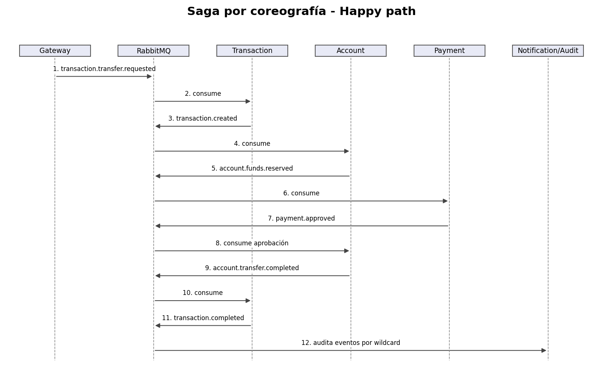

# Bank USAC - Documentación técnica

Esta carpeta documenta **Bank USAC en su Fase 3**. La solución mantiene **exactamente cinco microservicios**, un **API Gateway** como punto de entrada, comunicación asíncrona mediante **RabbitMQ** y una **base PostgreSQL independiente por microservicio**, desplegada en GCP por pipeline. La Fase 3 agrega observabilidad (OpenTelemetry, Prometheus, Tempo, Loki y Grafana), SLO con alertas, pruebas de carga y de fallo con postmortems, y depósitos interbancarios con el banco pareja (BANK13).

## Arquitectura final

| Componente | Tecnología | Puerto interno | Responsabilidad | Persistencia |
|---|---|---:|---|---|
| Customer Service | Spring Boot | 8081 | registro, identidad, activación, perfil, JWT | `bank_customer` |
| Account Service | NestJS + TypeORM | 3004 | cuentas, saldos, reservas y desactivación | `bank_account` |
| Transaction Service | NestJS + TypeORM | 3003 | ciclo de vida de la transferencia y Saga | `bank_transaction` |
| Payment Service | NestJS + TypeORM | 3005 | validación y registro independiente del pago | `bank_payment` |
| Notification & Audit Service | Spring Boot | 8082 | correo, auditoría y trazabilidad | `bank_notification` |
| API Gateway | NestJS | 8080 | JWT, roles, routing de borde, publicación de los comandos de transferencia y depósito, contrato `/interbank/v1` | sin BD |
| Frontend | React + TypeScript | 3000 | interfaz CLIENT/CASHIER/ADMIN | navegador |
| RabbitMQ | RabbitMQ 4 | 5672 | broker `bank.events`, retry y DLX | broker |
| MailHog | MailHog | 1025/8025 | SMTP de demostración | sin BD |
| interbank-mock | Node | 3010 | banco pareja simulado (BANK99) para pruebas y escenarios de fallo | memoria |
| Observabilidad | OTel Collector, Prometheus, Tempo, Loki, Grafana | — | trazas, métricas, logs, dashboards y alertas (namespace `observability`) | volúmenes propios |

## Funcionalidades de negocio

Sobre la base de la Fase 1, la solución incluye:

- gestión KYC con estados `PENDING`, `VERIFIED` y `REJECTED`;
- validación KYC previa al procesamiento de transferencias;
- tipos y reglas adicionales de cuentas;
- historial y estados ampliados de transacciones;
- simulación de pagos externos con `SUCCESS`, `FAILURE` y `TIMEOUT`;
- clasificación de auditoría `INFO`, `WARNING` y `ERROR`;
- eventos con trazabilidad mediante `eventId`, `correlationId` y, cuando aplica, `causationId`;
- CI/CD, infraestructura como código (Terraform) y despliegue en GKE y Cloud Run;
- depósitos interbancarios enviados y recibidos según el contrato OpenAPI del curso, con idempotencia, timeout, reversos y conciliación;
- trazas de punta a punta, métricas de negocio, logs JSON centralizados, SLO con error budget y alertas por burn rate.

> **Regla clave:** los cinco microservicios no se llaman entre sí mediante HTTP. La interacción distribuida de negocio se realiza por eventos RabbitMQ. El HTTP entre Gateway y un servicio es tráfico de borde para request/response del usuario; el Gateway no ejecuta lógica bancaria ni orquesta la Saga.

## Índice para calificación

1. [Arquitectura y diseño](01-arquitectura/01-vision-general.md)
2. [Modelo de dominio y bounded contexts](01-arquitectura/02-modelo-dominio.md)
3. [API Gateway y seguridad](01-arquitectura/03-api-gateway-seguridad.md)
4. [Persistencia y data ownership](01-arquitectura/04-persistencia-data-ownership.md)
5. [Decisiones arquitectónicas](01-arquitectura/05-decisiones-arquitectura.md)
6. [Catálogo de diagramas](01-arquitectura/06-catalogo-diagramas.md)
7. [C4 Nivel 1 — Contexto Fase 2](01-arquitectura/07-c4-contexto-fase2.md)
8. [C4 Nivel 3 — Customer y Notification & Audit](01-arquitectura/08-c4-componentes-integrante1-fase2.md)
9. [C4 Nivel 2 — Contenedores](01-arquitectura/09-c4-contenedores.md)
10. [Contratos de eventos](02-eventos/01-contratos-eventos.md)
11. [Topología RabbitMQ](02-eventos/02-topologia-rabbitmq.md)
12. [Saga de transferencia](03-saga/01-saga-transferencia.md)
13. [Docker Compose](04-despliegue/01-docker-compose.md)
14. [Kubernetes kind](04-despliegue/02-kubernetes-kind.md)
15. [NetworkPolicy](04-despliegue/03-network-policy.md)
16. [CI/CD](04-despliegue/04-ci-cd.md) y [Terraform](04-despliegue/05-terraform-cloud-sql.md)
17. [Prueba de carga del HPA](04-despliegue/06-prueba-hpa.md)
18. [Resiliencia y observabilidad](05-operacion/01-resiliencia-observabilidad.md)
19. [SLI, SLO y SLA](05-operacion/02-sli-slo-sla.md)
20. [Casos de uso](uml/use-cases.md)
21. [Pruebas](07-pruebas/01-estrategia-pruebas.md)
22. [Guía de demostración](07-pruebas/02-guia-demostracion.md)
23. [Checklist de calificación](07-pruebas/03-checklist-calificacion.md)
24. [Manual de usuario](08-manuales/01-manual-usuario.md)
25. [Referencia API](08-manuales/02-referencia-api.md)
26. [Matriz requisito-evidencia](09-calificacion/01-matriz-requisito-evidencia.md)
27. [Guion de sustentación](09-calificacion/02-guion-sustentacion.md)

### Fase 3

28. [Despliegue (dev y producción)](04-despliegue/07-despliegue-fase3.md)
29. [Saga del depósito interbancario](03-saga/02-deposito-interbancario.md)
30. [Diseño interbancario](interbank/diseno-interbancario.md) y [acuerdo de integración con BANK13](interbank/acuerdo-integracion.md)
31. [Convenciones de observabilidad](observabilidad/convenciones.md) y [catálogo de métricas](observabilidad/catalogo-metricas.md)
32. [Pruebas de carga](pruebas/carga.md) y [escenarios de fallo](pruebas/escenarios-de-fallo.md)
33. [Postmortems](postmortems/)
34. Runbooks por alerta: [`observability/runbooks/`](../observability/runbooks/)

## Diagramas principales

