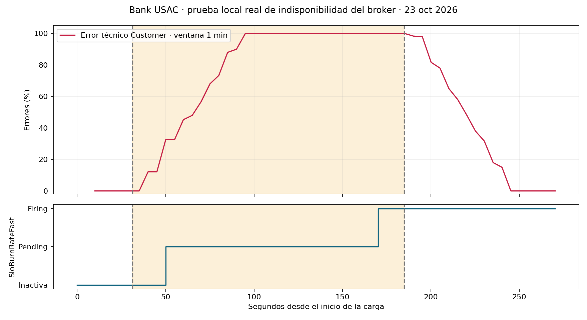

# Postmortem de Alex: broker no disponible durante carga de registro

**Fecha:** 23 de octubre de 2026. **Entorno:** local aislado, no producción. **Responsable:** Alex, Customer + Notification & Audit. **Severidad de la prueba:** media; registro indisponible, sin movimientos de dinero.

Durante cuatro minutos de carga k6 a un registro/s se detuvo la aplicación RabbitMQ del contenedor temporal y se restauró. Hubo **153 respuestas fallidas de 241 solicitudes (63.48 %)**; las **88 aceptadas quedaron confirmadas en Customer y auditadas en Notification**. Al finalizar no quedaban tareas outbox pendientes ni fallidas. El fallo activó SloBurnRateFast y la notificación fue registrada por el receptor real.

## Cronología medida (UTC; Guatemala = UTC−6)

| UTC | Segundos desde inicio | Hecho |
|---|---:|---|
| 06:28:09 | 0.0 | Inicio de carga Customer a 1 registro/s; baseline 30 s |
| 06:28:39 | 30.0 | Inicio de inyección: detener aplicación RabbitMQ local |
| 06:28:40 | 31.2 | RabbitMQ detenido; mantener carga 150 s |
| 06:31:14 | 184.9 | RabbitMQ restaurado |
| 06:32:13 | 244.4 | Carga terminada; observar recuperación 30 s |
| 06:32:43 | 274.4 | Fin de observación |

La ventana comenzó a las **00:28:09 de Guatemala**. RabbitMQ estuvo detenido aproximadamente **153.7 s**. La alerta entró en Pending a los 50.1 s y en Firing a los 170.2 s del inicio: **139.0 s después de confirmar la caída**, con resolución temporal de muestreo cercana a 5 s.

## Impacto y SLO

- HTTP: p95 general **291.12 ms** y p95 de respuestas aceptadas **376.47 ms**. Los rechazos rápidos no se interpretan como buen servicio: la tasa de error fue 63.48 %.
- Se conservaron las reglas existentes del equipo (99.9 % de operaciones sin error técnico). En la muestra de 241 peticiones, ese objetivo permite 0.241 fallos; 153 lo exceden ampliamente. Esto describe la muestra y **no pretende medir un presupuesto mensual completo**.
- SloBurnRateFast fue observado en Prometheus y entregado por Alertmanager a Notification. Ver `slo-delivery.json`, `samples.json` y `queries-final.json`.
- La comprobación SQL posterior encontró 88 clientes confirmados y 88 registros de auditoría del periodo; pendientes outbox = 0 y fallidas = 0. No se evaluaron saldos, Saga ni HPA en este escenario de dominio.

## Evidencia real

- [Resumen k6](../pruebas/evidencia-alex-2026-10-23/k6-resumen.txt), [cronología](../pruebas/evidencia-alex-2026-10-23/timeline.json), [muestreo Prometheus](../pruebas/evidencia-alex-2026-10-23/samples.json).
- [Auditoría de la alerta recibida](../pruebas/evidencia-alex-2026-10-23/slo-delivery.json) y [comprobación de recuperación](../pruebas/evidencia-alex-2026-10-23/outcome.json).
- [Log ERROR correlacionado de la verificación de corrección](../pruebas/evidencia-alex-2026-10-23/log-error-correlacionado.json). Se obtuvo en una comprobación breve posterior, no se presenta como un log de la ventana principal.
- Dashboard y traza del ciclo de vida en la misma carpeta de evidencias. Sus capturas son del entorno local; no acreditan GKE.

## Causa y comportamiento

La causa fue la inyección controlada `rabbitmqctl stop_app` en el broker temporal. Customer no pudo publicar el evento y revirtió el registro en su transacción. Las solicitudes que recibieron 200 sí quedaron persistidas y auditadas. Notification recuperó su consumidor al volver RabbitMQ; su inbox impidió duplicar registros y el outbox reintentó las publicaciones pendientes. SMTP quedó separado del consumo.

## Acciones y verificación

| Acción | Estado |
|---|---|
| Inbox/outbox transaccional, ids estables y publisher confirms | Implementado; 88/88 y cero tareas pendientes/fallidas tras recuperación |
| Readiness de Notification por aplicación/DB, para conservar consulta y webhook durante caída del broker | Implementado; verificación posterior respondió UP con el broker detenido |
| Registrar fallo técnico dentro de su span, con tipo de excepción y sin texto sensible | Implementado; log ERROR con correlationId/traceId verificado en una prueba breve posterior |
| Probar la misma configuración desplegada, HPA y recuperación en GKE | Pendiente de acceso y promoción normal por release/main |
| Escenario interbancario obligatorio con mock, coordinación BANK13 y evidencias conjuntas | Pendiente compartido, fuera de este escenario |

SMTP conserva semántica **al menos una vez**: una caída entre el envío y el commit puede repetir el correo. El NotificationId permite reconocerlo; no se afirma exactamente una vez para SMTP. La prueba tampoco demuestra una ventana mensual completa de SLO.
