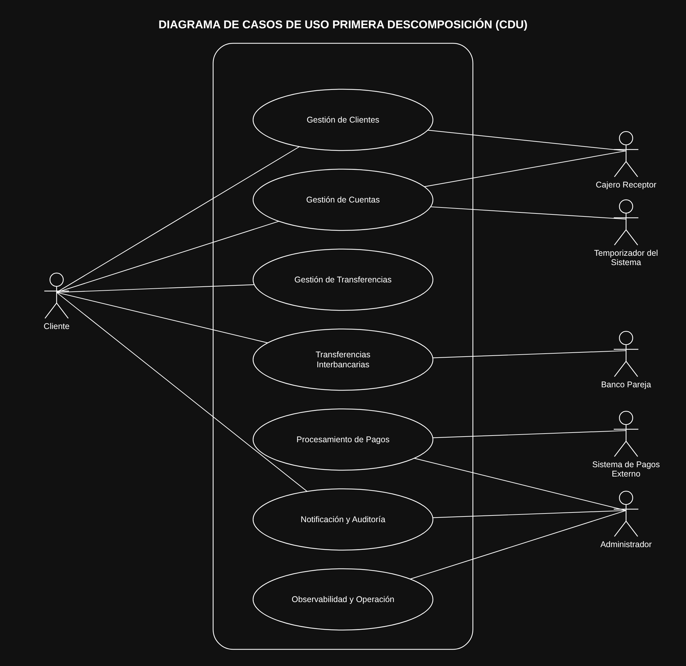
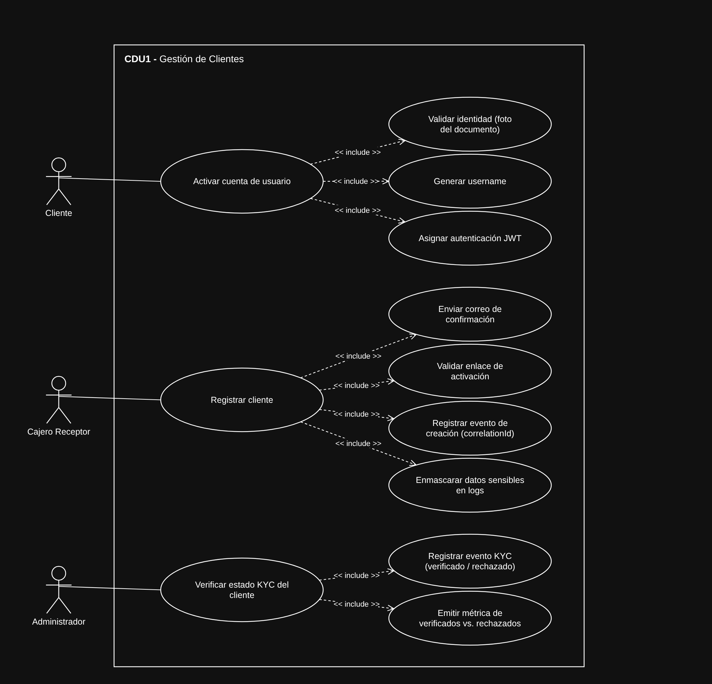
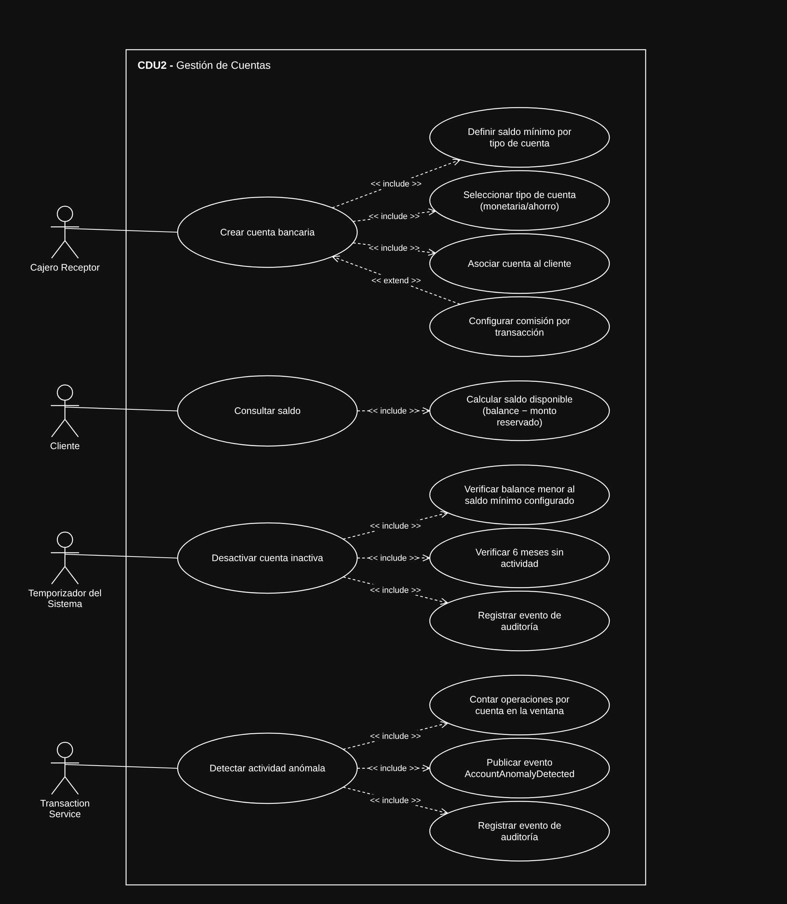
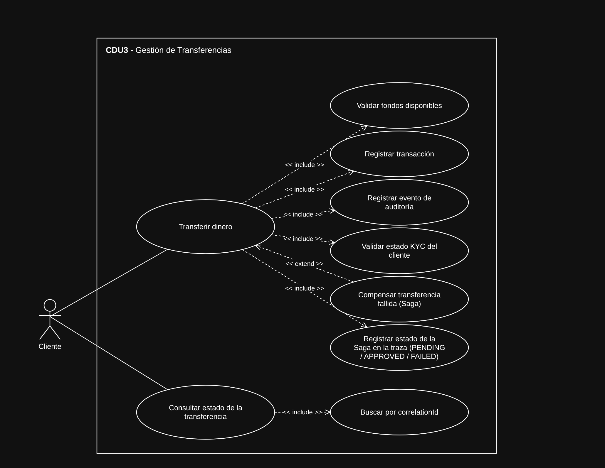
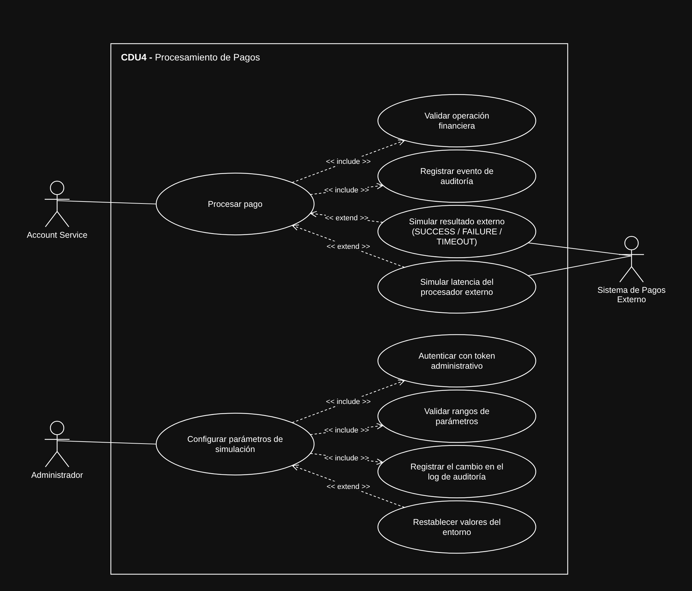
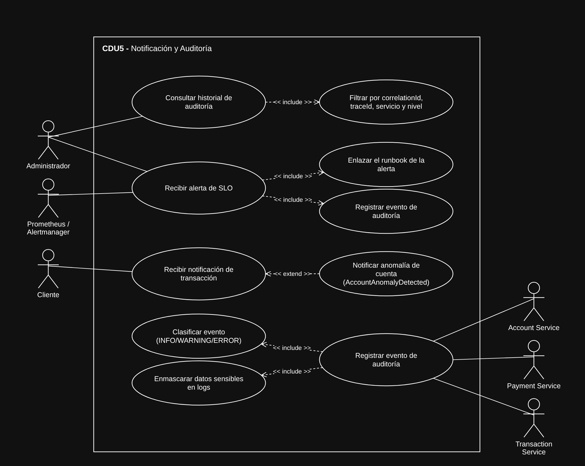
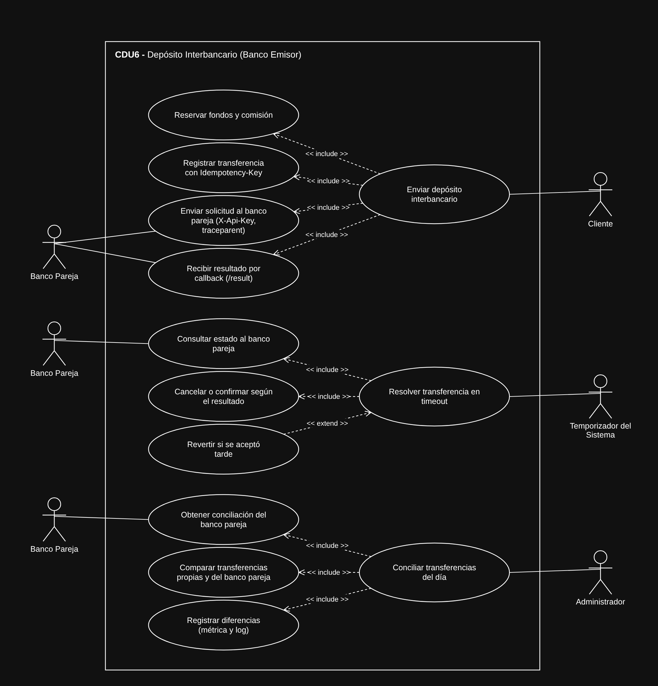
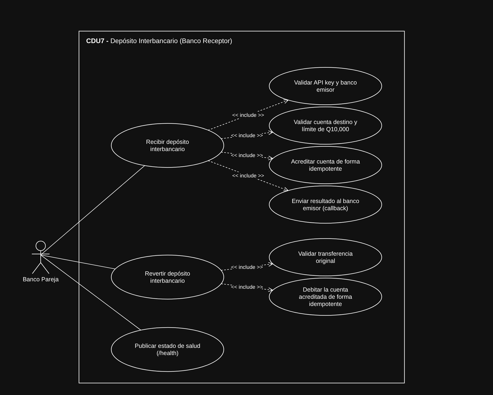
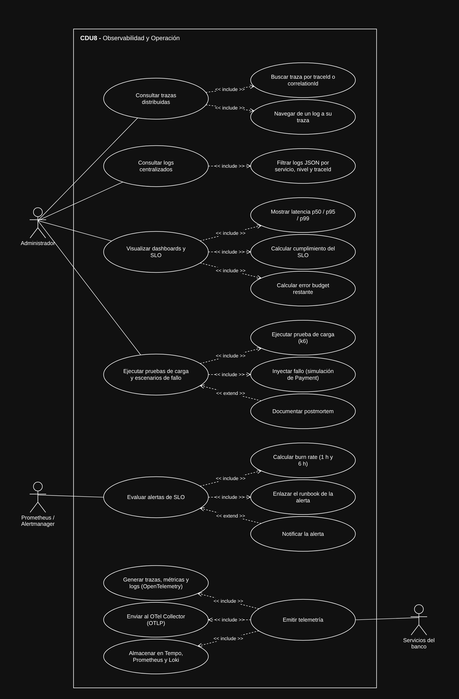

# Diagrama de Casos de Uso

Este documento describe los casos de uso del sistema Bank USAC, organizados por microservicio, incluyendo actores, relaciones `<<include>>`/`<<extend>>`, y conexiones entre casos de uso de distintos microservicios. Se actualizó en la Fase 3 para incorporar la observabilidad, la detección de anomalías, la simulación de fallos y los depósitos interbancarios.

## Descomposición general

El sistema cuenta con 6 actores principales (Cliente, Cajero Receptor, Administrador, Temporizador del Sistema, Sistema de Pagos Externo y Banco Pareja) y 7 grupos de casos de uso: Gestión de Clientes, Gestión de Cuentas, Gestión de Transferencias, Transferencias Interbancarias, Procesamiento de Pagos, Notificación y Auditoría, y Observabilidad y Operación. Los casos de uso de Fase 3 son Transferencias Interbancarias y Observabilidad y Operación; además se amplían los casos de uso existentes (ver cada sección). En los diagramas de detalle aparecen también actores internos: Account Service, Transaction Service y Payment Service (servicios que disparan operaciones por eventos), Prometheus / Alertmanager (sistema de alertas) y Servicios del banco (emisores de telemetría).

## Casos de uso por actor

**CLIENT**
- registrarse, recibir el correo y activar la cuenta;
- autenticarse con JWT;
- consultar y actualizar el perfil;
- crear una cuenta `MONETARY` o `SAVINGS` propia, listar cuentas y consultar el saldo disponible;
- iniciar una transferencia desde una cuenta propia y consultar su estado por `correlationId`;
- enviar un depósito a una cuenta de otro banco (transferencia interbancaria) y consultar su resultado;
- recibir notificaciones de sus transacciones y de la actividad anómala detectada en sus cuentas.

**CASHIER**
- autenticarse con usuario sembrado;
- consultar o crear cuentas usando `customerId` cuando corresponde;
- consultar pagos procesados y el pago de una `transactionId`;
- ejecutar el mantenimiento autorizado de cuentas inactivas.

El backend no autoriza al CASHIER a iniciar transferencias; esa acción está restringida a `CLIENT` en el Gateway.

**ADMIN**
- autenticarse con usuario sembrado;
- consultar cuentas y pagos;
- consultar la auditoría distribuida, filtrando por `correlationId`, `traceId`, servicio y nivel;
- ejecutar el mantenimiento de cuentas inactivas y verificar el estado KYC de los clientes;
- ajustar en caliente los parámetros de simulación del procesador de pagos mediante el endpoint administrativo protegido;
- consultar trazas, logs, dashboards de SLO y error budget, y recibir las alertas de SLO con el enlace a su runbook;
- ejecutar la conciliación diaria de transferencias interbancarias y revisar las diferencias;
- ejecutar las pruebas de carga y los escenarios de fallo, y documentar su postmortem.

**Temporizador del sistema**
- El cron de Account desactiva diariamente las cuentas con más de seis meses de inactividad y saldo menor a Q50.
- El proceso de transferencias interbancarias aplica el protocolo de timeout: cuando una transferencia sigue sin resultado después de su vencimiento más el margen de seguridad, consulta el estado al banco pareja y la cancela, la confirma o la revierte según la respuesta.

**Banco pareja**
- Banco externo con el que se intercambian depósitos bajo el contrato interbancario común (`/interbank/v1`, autenticación con `X-Api-Key`, `Idempotency-Key` igual al `interbankTransferId` y `traceparent`). Cumple los dos roles: como banco receptor acredita depósitos, ejecuta reversas y publica `/health`; como banco emisor envía sus depósitos hacia nuestro banco y recibe nuestros callbacks de resultado.

**Servicios internos y sistemas de apoyo**
- Account, Transaction y Payment publican los eventos que se registran en la auditoría; Account publica además `account.anomaly.detected` cuando una cuenta supera el número de operaciones permitido en la ventana configurada.
- Prometheus / Alertmanager evalúa las alertas de SLO (incluida la de burn rate) y las notifica.
- Todos los servicios emiten trazas, métricas y logs con OpenTelemetry hacia el Collector.

## CDU001 — Gestión de Clientes

Actores: Cliente, Cajero Receptor, Administrador. Incluye registro de cliente (con correo de confirmación y validación del enlace de activación), activación de cuenta de usuario (validación de identidad, generación de username y asignación de autenticación JWT) y verificación del estado KYC por el Administrador.

Fase 3: cada cambio del ciclo de vida del cliente (creación, KYC verificado, KYC rechazado) registra un evento con `correlationId`, los datos sensibles (documento, correo, foto, JWT) se enmascaran en logs y trazas, y se emite una métrica de clientes verificados contra rechazados.

## CDU002 — Gestión de Cuentas

Actores: Cajero Receptor, Cliente, Temporizador del Sistema, Transaction Service. Incluye creación de cuenta (tipo de cuenta, saldo mínimo, asociación al cliente y comisión por transacción), consulta de saldo disponible (balance menos monto reservado) y desactivación automática de cuentas inactivas (proceso disparado por tiempo, sin intervención de un actor humano).

Fase 3: la detección de actividad anómala evalúa cada operación solicitada por Transaction Service. Cuando una cuenta de origen supera el número de operaciones permitido dentro de la ventana de tiempo configurada, Account publica una sola vez por ventana el evento `account.anomaly.detected` (consumido por Notificación y Auditoría) y registra el evento de auditoría.

## CDU003 — Gestión de Transferencias

Actor: Cliente. Incluye validación de fondos y del estado KYC, registro de transacción, registro del evento de auditoría y compensación de transferencia fallida (Saga).

Fase 3: los estados de la Saga (`PENDING`, `APPROVED`, `FAILED`) quedan registrados como eventos en la traza distribuida, de modo que una transferencia completa, incluidas las compensaciones, puede seguirse de punta a punta. El Cliente consulta el estado de una transferencia a partir de su `correlationId`.

## CDU004 — Procesamiento de Pagos

Actores: Account Service (como sistema externo desde la perspectiva de Payment Service), Sistema de Pagos Externo, Administrador. El procesamiento de pagos es disparado automáticamente por el evento `account.funds.reserved`, sin intervención manual del usuario final.

Fase 3: el Sistema de Pagos Externo se simula con resultado `SUCCESS`, `FAILURE` o `TIMEOUT` y con latencia configurable. El Administrador cambia estos parámetros en caliente (tasa de fallos, tasa de timeouts, duración del timeout y latencia añadida) mediante un endpoint administrativo protegido con token, sin redesplegar. El servicio valida los rangos, deja registrado el cambio en el log y permite restablecer los valores del entorno. Esta función habilita los escenarios de fallo de la Fase 3.

## CDU005 — Notificación y Auditoría

Actores: Administrador, Cliente, Prometheus / Alertmanager, Account Service, Transaction Service, Payment Service. El registro de eventos de auditoría es disparado por los demás microservicios del sistema cada vez que ocurre una operación relevante (transferencia, pago, desactivación de cuenta, anomalía); cada evento se clasifica (INFO/WARNING/ERROR) y se enmascaran los datos sensibles.

Fase 3: el Administrador consulta el historial filtrando por `correlationId`, `traceId`, servicio y nivel. El Cliente recibe notificación de sus transacciones y, cuando Account publica `account.anomaly.detected`, también la notificación de la anomalía detectada. Las alertas de SLO que dispara Prometheus / Alertmanager se notifican al Administrador junto con el enlace al runbook correspondiente y se registran en la auditoría.

## CDU006 — Depósito Interbancario (Banco Emisor)

Actores: Cliente, Temporizador del Sistema, Administrador, Banco Pareja. Cuando el cliente envía un depósito a otro banco, se reservan los fondos y la comisión, se registra la transferencia con `Idempotency-Key` igual al `interbankTransferId` y se envía la solicitud al banco pareja con `X-Api-Key` y el encabezado `traceparent` (W3C). El resultado llega por el callback `/result` del contrato interbancario.

Si el resultado no llega antes de que venza la transferencia (`expiresAt`, 180 segundos desde su creación) más el margen de 300 segundos, el Temporizador del Sistema aplica el protocolo de timeout: consulta el estado al banco pareja y cancela o confirma según la respuesta. Si el banco pareja aceptó fuera de tiempo, se ejecuta la reversa. El Administrador concilia diariamente las transferencias propias contra las del banco pareja y se registran las diferencias como métrica y log.

## CDU007 — Depósito Interbancario (Banco Receptor)

Actor: Banco Pareja. Es el rol inverso del caso anterior. Al recibir un depósito, se valida la API key y el banco emisor, se valida la cuenta destino y el límite de Q10,000, se acredita la cuenta de forma idempotente (repetir el mismo `interbankTransferId` no acredita dos veces) y se informa el resultado al banco emisor por callback. También incluye la reversa de un depósito ya acreditado (se valida la transferencia original y se debita la cuenta una sola vez) y la publicación del estado de salud del banco (`/health`).

## CDU008 — Observabilidad y Operación

Actores: Administrador, Prometheus / Alertmanager, Servicios del banco. Los servicios del banco emiten trazas, métricas y logs con OpenTelemetry, los envían al OTel Collector (OTLP) y se almacenan en Tempo, Prometheus y Loki. El Administrador consulta trazas distribuidas (por `traceId` o `correlationId`, y navega de un log a su traza), consulta los logs JSON centralizados y visualiza los dashboards: latencia p50 / p95 / p99, cumplimiento del SLO y error budget restante.

Prometheus evalúa las alertas de SLO, incluida la de burn rate (ventanas de 1 h y 6 h), enlaza el runbook de cada alerta y notifica. El Administrador también ejecuta las pruebas de carga (k6) y los escenarios de fallo (simulación en Payment) y documenta el postmortem de cada uno.

